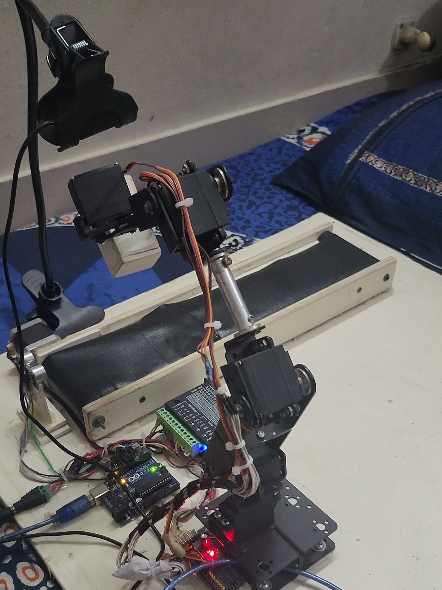
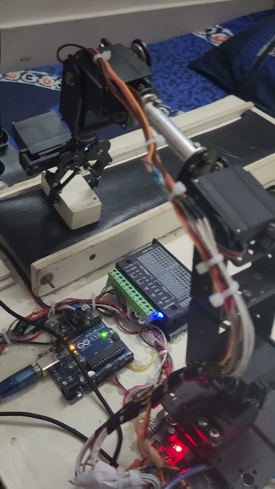
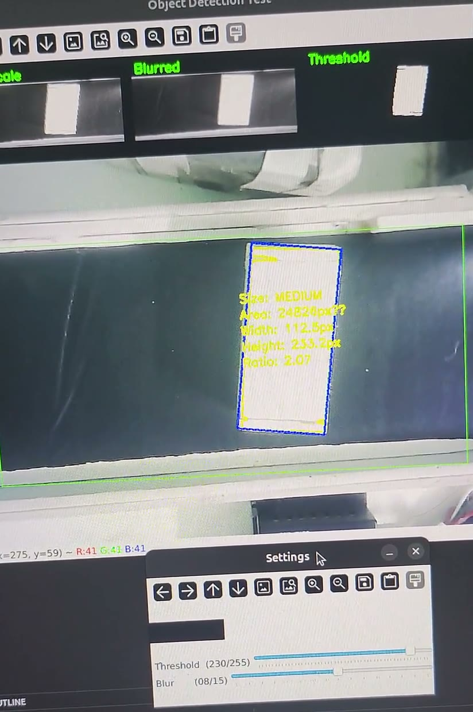
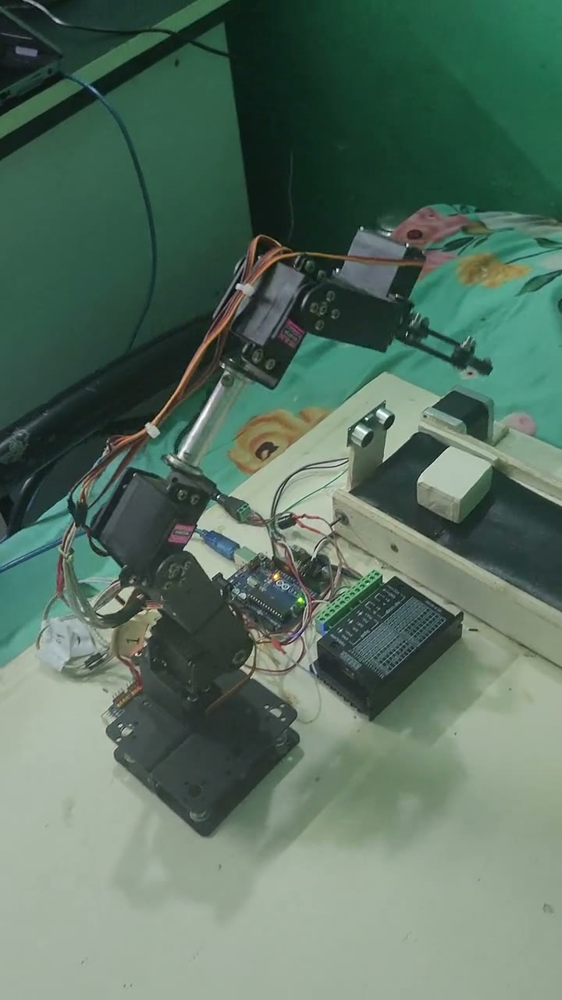
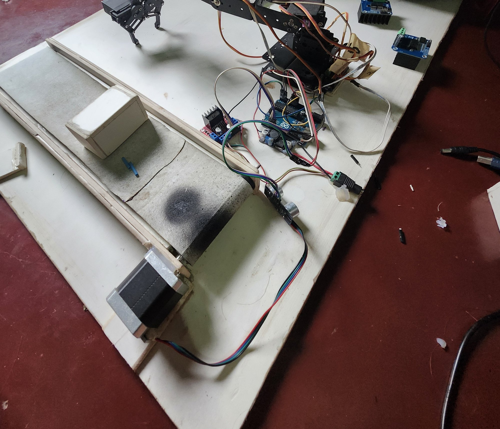
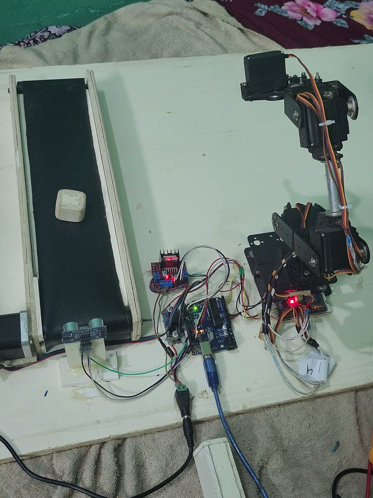
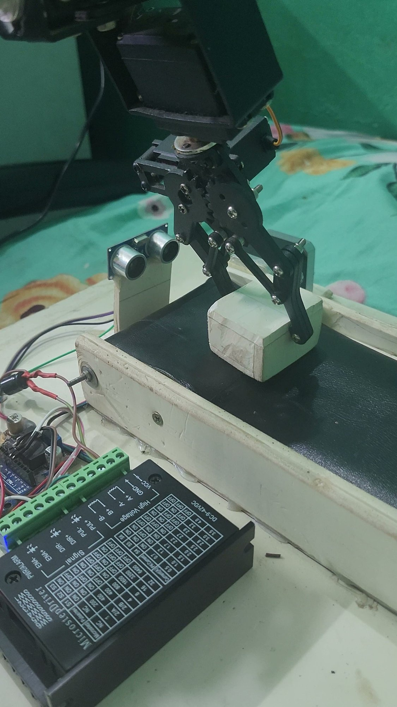
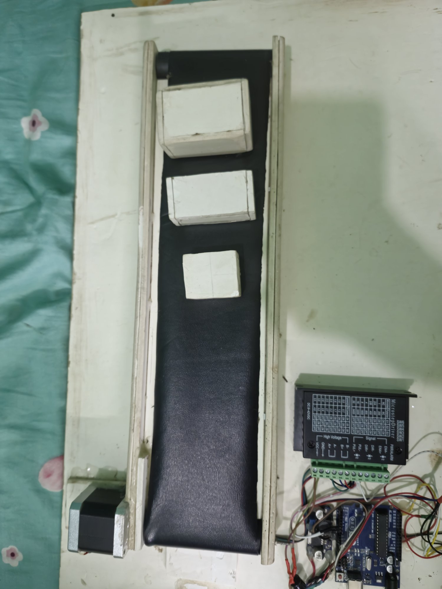
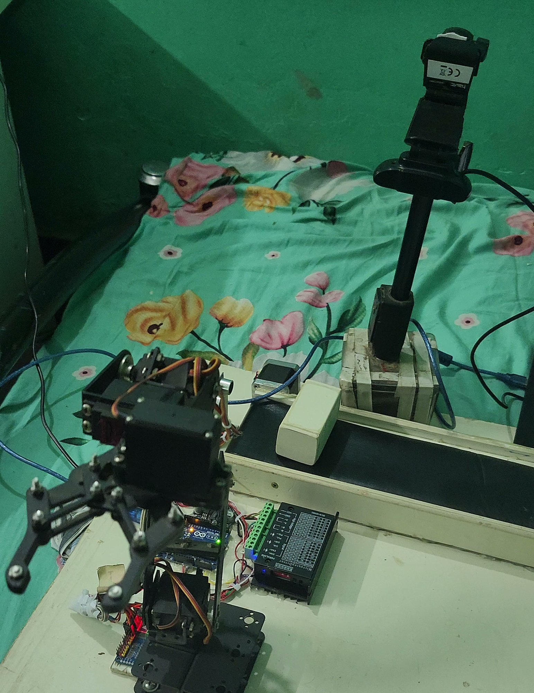

# ConveySort-Arm

A six-servo robot arm and a conveyor belt that sort blocks by size. A
camera and OpenCV measure each block on the belt, and an Arduino stops the
belt and has the arm set the block down in the place for its size. Built
and run in October and November 2024.



**It working, November 2024:**

| | | |
|---|---|---|
| <a href="docs/media/conveysort-arm-2024-11-18-arm-camera-and-conveyor.mp4"></a><br>**11-18:** the whole system: the webcam watches the belt, and the arm takes the block off it, sets it down and goes back ([video](docs/media/conveysort-arm-2024-11-18-arm-camera-and-conveyor.mp4), 35 s) | <a href="docs/media/conveysort-arm-2024-11-16-camera-detection.mp4"></a><br>**11-16:** the tuning window's view: each frame turned grey, blurred and thresholded, then the block outlined, measured and called small, medium or large ([video](docs/media/conveysort-arm-2024-11-16-camera-detection.mp4), 14 s) | <a href="docs/media/conveysort-arm-2024-11-16-belt-sensor-and-arm.mp4"></a><br>**11-16:** one cycle before the camera: the belt brings a block to the ultrasonic sensor, and the arm picks it up and sets it down ([video](docs/media/conveysort-arm-2024-11-16-belt-sensor-and-arm.mp4), 38 s) |

## What it does

- **Measures each block.** [`src/vision/sort_by_size.py`](src/vision/sort_by_size.py)
  reads the webcam, turns each frame grey, blurs and thresholds it, and
  finds the block's outline. By its area, a block under 17,000 px² is
  small, under 28,000 px² medium, and anything bigger large.
- **Tells the Arduino.** Once the same size has held for 10 more frames
  in a row, the script sends `1`, `2` or `3` over USB serial, at most once
  every 5 seconds.
- **Runs the belt.** [`firmware/conveyor-sorter/`](firmware/conveyor-sorter)
  turns the belt's stepper motor while an ultrasonic sensor sees a block
  coming (7 to 45 cm away), and stops it when the block reaches the sensor
  at the end of the belt.
- **Sorts it.** With the block in place, the arm grips it, tighter for
  smaller blocks, and turns its base to 90°, 50° or 10° to set a small,
  medium or large block down in its own place. Then it goes home. Each
  video shows one block picked and set down.

**Written, but not shown running:** a ROS 2 workspace for the arm, with
its model, a hardware interface, MoveIt and launch files for RViz, Gazebo
and the real arm (see [ROS 2](#ros-2)). It is separate from the sorter,
and no video shows it driving the arm.

## The build

October and November 2024, in date order.

| | | |
|---|---|---|
| <br>**10-05:** the first version on one board: a cloth belt turned by a stepper motor, an ultrasonic sensor, an Arduino and the servo arm | <br>**11-11:** a black belt that ends at the ultrasonic sensor; a block rides toward it while the arm waits | <br>**11-16:** the block has reached the sensor and the gripper closes on it; in front is the TB6600 driver that runs the belt's motor |
| <br>**11-16:** the conveyor from above, with the three test sizes, the stepper motor at one end, and the driver and Arduino Uno beside it | <br>**11-16, evening:** a webcam on a stand now looks down at the belt; by 11-18 it is on a clamp | |

## How it works

| | |
|---|---|
| Arm | Six servos: base, shoulder, elbow, wrist pitch, wrist roll and gripper, on a PCA9685 board (channels 8, 2, 3, 5, 6 and 7). They move in small steps (5 PWM counts, about 2°, every 40 ms), and the last position is saved to EEPROM at most every 5 s |
| Belt | A stepper motor through a TB6600 driver (STEP on pin 5, DIR on pin 6), with an HC-SR04 ultrasonic sensor (TRIG on pin 9, ECHO on pin 8) at the end of the belt |
| Controller | An Arduino Uno running [`firmware/conveyor-sorter/conveyor-sorter.ino`](firmware/conveyor-sorter/conveyor-sorter.ino), which takes `0` (home) and `1` to `3` (a block's size) over serial at 9600 baud |
| Vision | A webcam above the belt and OpenCV on a PC: [`src/vision/sort_by_size.py`](src/vision/sort_by_size.py) runs the sort, and [`src/vision/object_size_detection.py`](src/vision/object_size_detection.py) shows the detector in its own window, with a grey, blur and threshold preview strip, to tune it (its medium limit is 25,000 px²) |
| ROS 2 | A separate workspace in [`src/conveysort_*`](src): see [ROS 2](#ros-2) |

### ROS 2

Ten ROS 2 Humble packages, from Antonio Brandi's arduinobot course (see
[My part](#my-part)), renamed and fitted to this arm:

| Package | Holds |
|---|---|
| [`conveysort_description`](src/conveysort_description) | The arm's model in URDF/xacro, with its meshes, and launch files for RViz and Gazebo Classic |
| [`conveysort_controller`](src/conveysort_controller) | The ros2_control setup for the arm and gripper, a hardware plugin that sends joint angles to the Arduino over serial, and a slider node |
| [`conveysort_moveit`](src/conveysort_moveit) | The MoveIt 2 setup: planning groups, kinematics and limits |
| [`conveysort_bringup`](src/conveysort_bringup) | Launch files that start the simulated arm or the real one |
| [`conveysort_remote`](src/conveysort_remote) | A task server with preset moves, and an Alexa skill endpoint |
| [`conveysort_msgs`](src/conveysort_msgs) | The task action, and the course's example action and services |
| [`conveysort_firmware`](src/conveysort_firmware) | Serial test nodes; the sketch for the ROS 2 real-robot path is [`firmware/ros2-robot-control/`](firmware/ros2-robot-control) |
| [`conveysort_utils`](src/conveysort_utils) | Euler and quaternion conversion services |
| [`conveysort_cpp_examples`](src/conveysort_cpp_examples), [`conveysort_py_examples`](src/conveysort_py_examples) | The course's exercises in C++ and Python |

The main changes from the course: the arm's model, from my team's
EnviroBot project, and six servos instead of four in the hardware plugin,
the Python slider node, the controllers and the sketch for the ROS 2
real-robot path.

## Repository layout

| Folder | Holds |
|---|---|
| [`src/vision/`](src/vision) | The sorter's program and the detector on its own, in Python |
| [`firmware/`](firmware) | The sorter's sketch, and the one written for the ROS 2 real-robot path |
| [`src/conveysort_*`](src) | The ROS 2 workspace, one folder per package |
| [`experiments/`](experiments) | The first tests of the belt, the sensor and the servos, a phone-control test on an ESP32, and the course's serial sketches |
| [`docs/media/`](docs/media) | The photos and videos on this page |
| [`scripts/`](scripts) | The script that starts the dev container with the host's display |
| [`.devcontainer/`](.devcontainer) | A VS Code dev container with ROS 2 Humble, MoveIt and Gazebo |

## My part

All the commits here are mine. I wrote the sorter, its vision script and
its sketch, and the belt, sensor and servo tests in
[`experiments/`](experiments), and fitted the ROS 2 course code to this
arm. The sorter's code was committed in April 2026.

It stands on others' work:

- The ROS 2 workspace, and the course sketches in
  [`firmware/ros2-robot-control/`](firmware/ros2-robot-control) and
  [`experiments/ros2-course/`](experiments/ros2-course), are Antonio
  Brandi's arduinobot code from his course "Robotics and ROS 2 - Learn by
  Doing! Manipulators"
  ([its repository](https://github.com/AntoBrandi/Robotics-and-ROS-2-Learn-by-Doing-Manipulators)),
  with the names changed and the parts above fitted to this arm.
- The arm's model comes from
  [EnviroBot](https://github.com/jewel-nath/envirobot), the final-year
  project I built at Comilla University with Tasmiara Jahan Toma and
  Tanjina Akter. Its meshes were in EnviroBot too, but are older (2018
  exports), and their first source is not known.
- The ESP32 phone-control test started from Ujwal Nandanwar's
  [RobotArm](https://github.com/un0038998/RobotArm) sketch.
- The dev container follows the ROS 2 documentation's guide,
  [Setup ROS 2 with VSCode and Docker](https://docs.ros.org/en/humble/How-To-Guides/Setup-ROS-2-with-VSCode-and-Docker-Container.html).

## Run it

These steps record how it was set up in 2024: OpenCV 4.10 on the PC, and
ROS 2 Humble with Gazebo Classic, which reached its end of life in
January 2025.

### The sorter

1. In the Arduino IDE, install the **Adafruit PWM Servo Driver** library
   and upload [`firmware/conveyor-sorter/conveyor-sorter.ino`](firmware/conveyor-sorter/conveyor-sorter.ino)
   to an Arduino Uno wired as in [How it works](#how-it-works).
2. On the PC, with the webcam and the Arduino plugged in:

   ```bash
   pip install -r requirements.txt
   python src/vision/sort_by_size.py
   ```

   The serial port is set to `COM3` and the camera to `0` at the bottom of
   [`sort_by_size.py`](src/vision/sort_by_size.py); change them to yours.
   Press `q` to stop.

To tune the detector, run `python src/vision/object_size_detection.py`
(it opens camera `4`; change it at the bottom of the file).

### The ROS 2 workspace

On Ubuntu 22.04 with ROS 2 Humble, from the repository's root:

```bash
rosdep install --from-paths src --ignore-src -y
colcon build
source install/setup.bash
ros2 launch conveysort_description display.launch.py
```

`display.launch.py` is written to show the arm in RViz with a slider for
each joint, and `ros2 launch conveysort_bringup simulated_robot.launch.py`
to start Gazebo, the controllers and MoveIt; neither is shown running. colcon skips `src/vision/`, which is not a ROS
package.

Or build the dev container's image from the root and start it:

```bash
docker build -t conveysort_arm_image -f .devcontainer/Dockerfile .
./scripts/run-container.sh
```

### The ESP32 test

Copy [`secrets.example.h`](experiments/esp32-phone-control/secrets.example.h)
to `secrets.h` next to the sketch and choose a password for the ESP32's
access point. `secrets.h` stays out of git.

## Known problems

These are in the code as it is; none of them affects the sorter's videos.

- **ROS 2 tasks:** the task server's and the MoveIt examples' preset poses
  are still the course's three-joint values, and the C++ slider node sends
  three arm joints, so as written they can't move this five-joint arm.
- **ROS 2 serial:** the hardware plugin sends angles without leading zeros
  (`b90,`), and [`ros2-robot-control.ino`](firmware/ros2-robot-control/ros2-robot-control.ino)
  reads them into a three-digit buffer, so an angle under 100 is misread.
  That sketch also drives the servos straight from Arduino pins, not from
  the PCA9685 board the built arm uses.
- **The model:** `joint_7`'s lower limit is above its upper limit, and the
  simulated arm's ros2_control block declares a second hardware plugin
  that is never loaded.
- **The dev container:** `devcontainer.json` builds without
  `"context": ".."`, so the Dockerfile's `COPY src/` fails in VS Code;
  the `docker build` above runs from the root, so `COPY src/` finds the
  packages.
- **The Alexa endpoint** needs Flask and the ASK SDK, which no file
  declares, and a real skill ID.
- **The sorter:** if the ultrasonic sensor has never had a good reading,
  the sketch keeps sending the arm home and ignores serial commands.

## Licence

My code is under the MIT licence: see [LICENSE](LICENSE). The ROS 2
packages in `src/conveysort_*` and the sketches in
`firmware/ros2-robot-control/` and `experiments/ros2-course/` come from
Antonio Brandi's course and stay under the Apache License 2.0: see
[LICENSE-APACHE](LICENSE-APACHE). Each of those files says so at its top.
The exception is the arm's model and meshes in `src/conveysort_description/`,
which come from EnviroBot, where no licence was stated.
The ESP32 test keeps Ujwal Nandanwar's MIT notice, the dev container
credits the ROS 2 documentation (CC BY 4.0), and the Python package's test
files keep the Open Source Robotics Foundation's Apache notices.
