# Diagrams

Every diagram and plot from the [technical report](../report/README.md), each as
its own file:

- **PDF:** vector, sharp at any size. Use it for print, slides and LaTeX.
- **PNG:** 200 dpi on white. Use it for READMEs, posts and web pages.

They share one colour code: green is the PC and its program, purple vision
(the webcam and OpenCV), orange the serial link, blue motion (the Arduino,
the belt and the arm), and grey other hardware.

| Diagram | What it shows | Files |
|---|---|---|
| 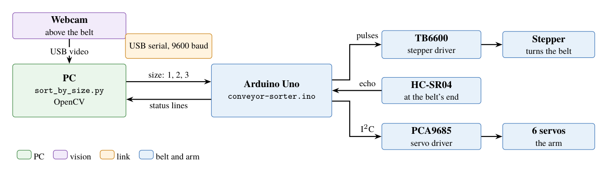 | The whole cell: the PC, the webcam, the Arduino, the belt and the arm | [PDF](conveysort-arm-system-overview.pdf) · [PNG](conveysort-arm-system-overview.png) |
| 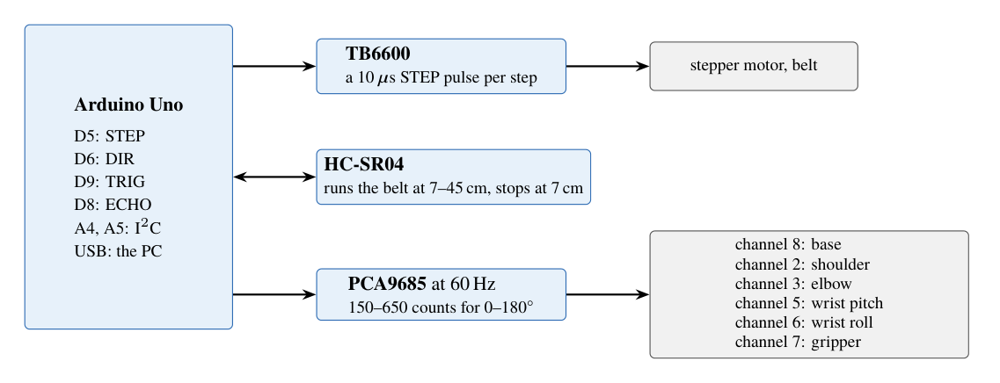 | The Arduino's pins and the servo channels | [PDF](conveysort-arm-wiring.pdf) · [PNG](conveysort-arm-wiring.png) |
| 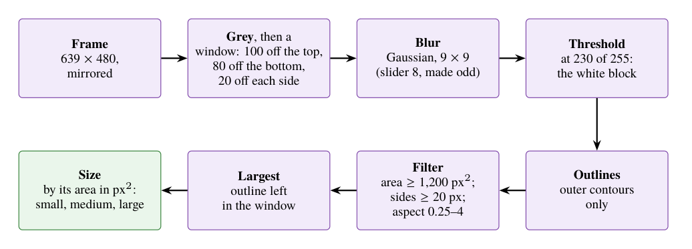 | How the PC sizes a block | [PDF](conveysort-arm-vision-pipeline.pdf) · [PNG](conveysort-arm-vision-pipeline.png) |
| 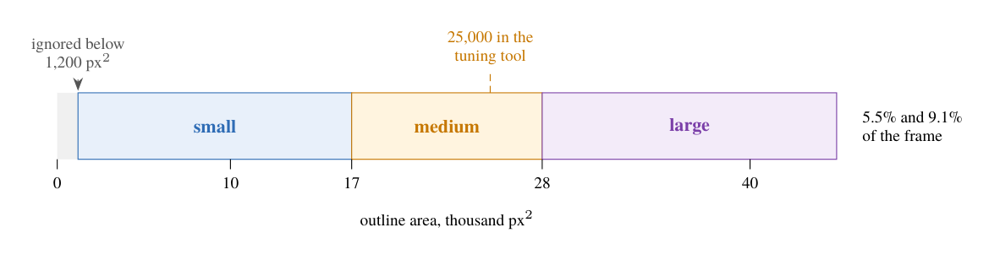 | The size classes by outline area | [PDF](conveysort-arm-size-bands.pdf) · [PNG](conveysort-arm-size-bands.png) |
| 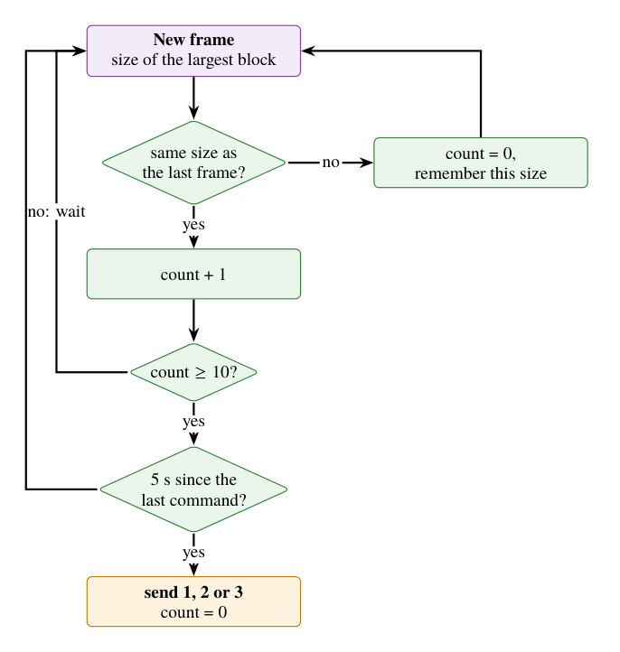 | When the PC sends a size: ten steady frames, five seconds apart | [PDF](conveysort-arm-decision-logic.pdf) · [PNG](conveysort-arm-decision-logic.png) |
| 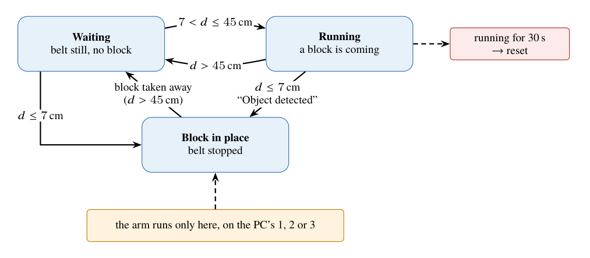 | The belt's states, from the ultrasonic distance | [PDF](conveysort-arm-belt-states.pdf) · [PNG](conveysort-arm-belt-states.png) |
| 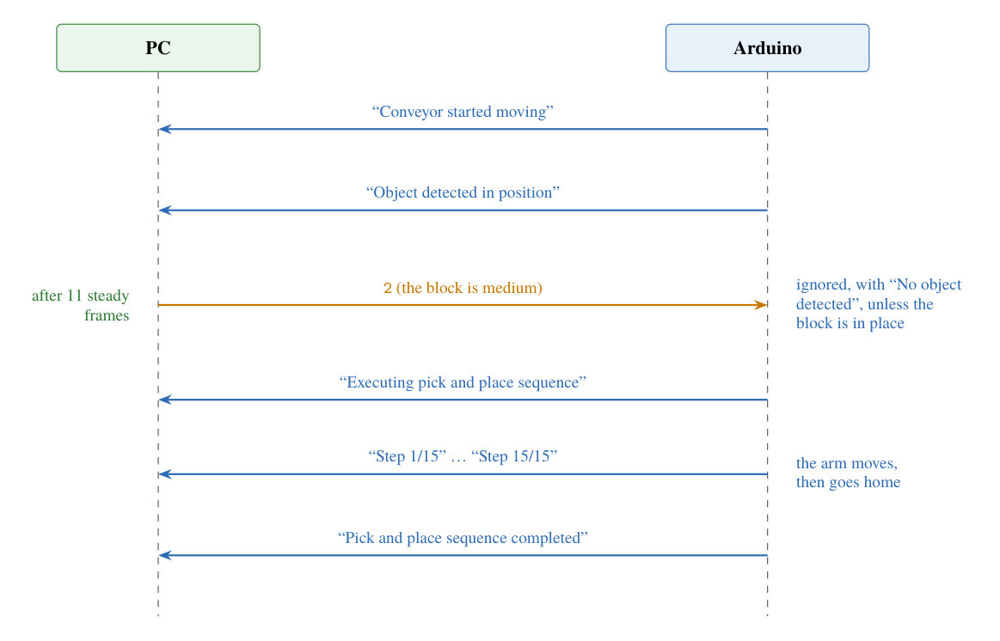 | One sort, as the messages over the serial link | [PDF](conveysort-arm-serial-exchange.pdf) · [PNG](conveysort-arm-serial-exchange.png) |
| 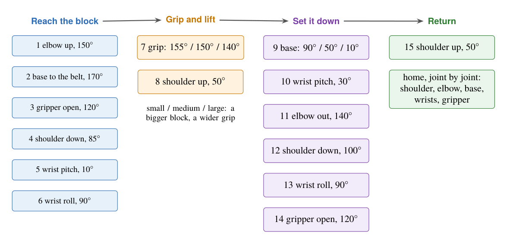 | The 15-step pick-and-place | [PDF](conveysort-arm-pick-place.pdf) · [PNG](conveysort-arm-pick-place.png) |
| 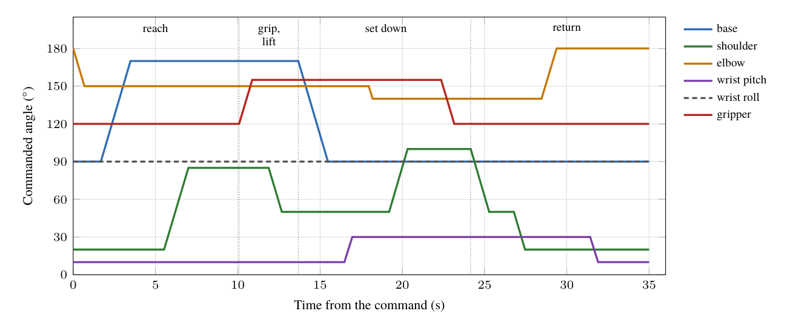 | Each joint's commanded angle over one sort, computed from the firmware | [PDF](conveysort-arm-joint-angles.pdf) · [PNG](conveysort-arm-joint-angles.png) |
| 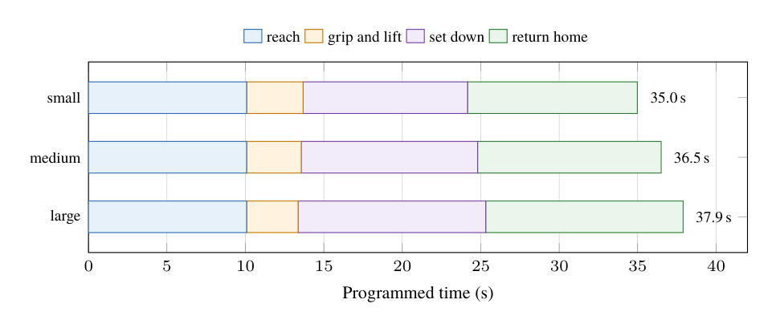 | The programmed time of one sort, by block size | [PDF](conveysort-arm-cycle-time.pdf) · [PNG](conveysort-arm-cycle-time.png) |
| 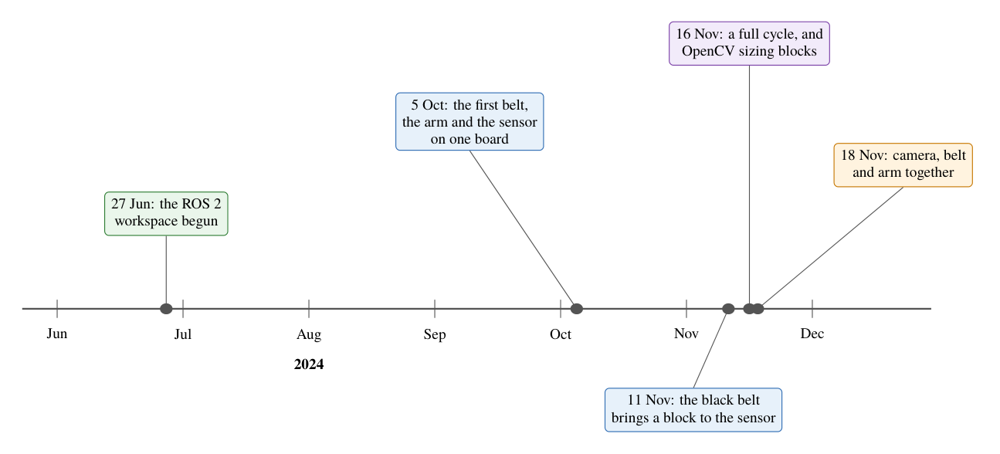 | The build in 2024 | [PDF](conveysort-arm-timeline.pdf) · [PNG](conveysort-arm-timeline.png) |
| 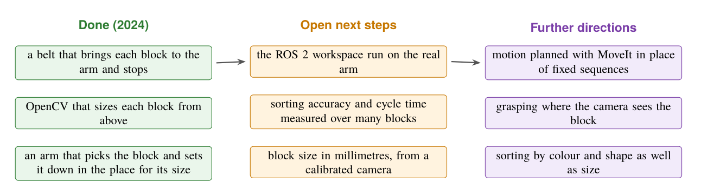 | What the cell showed in 2024, and the open steps | [PDF](conveysort-arm-roadmap.pdf) · [PNG](conveysort-arm-roadmap.png) |
| 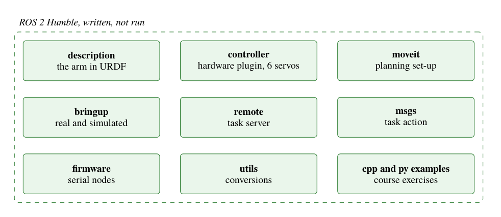 | The ROS 2 workspace, adapted from Antonio Brandi's course; written, not run | [PDF](conveysort-arm-ros2-packages.pdf) · [PNG](conveysort-arm-ros2-packages.png) |

To rebuild them, run `python make-diagrams.py` in [`../report/`](../report/).
